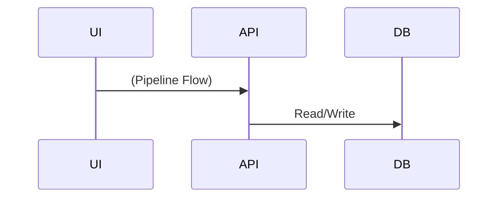

# P1: guest-order

**Purpose**: guest QR -> order -> KOT -> add-on -> bill request -> POS settle -> table vacate

## Sequence Diagram

## File List
(Static analysis approximation)

## Names Used
(Refer to naming-drift.md)

## External APIs / Stores
(Refer to state-and-data-sources.md)

## Failure Points
- JUDGMENT: Needs manual review of atomic operations and error handling in guest-order routes.

## Status
- OVERALL: PARTIAL / STUB

## Tests
- Refer to vitest summary in inventory-loc.md
